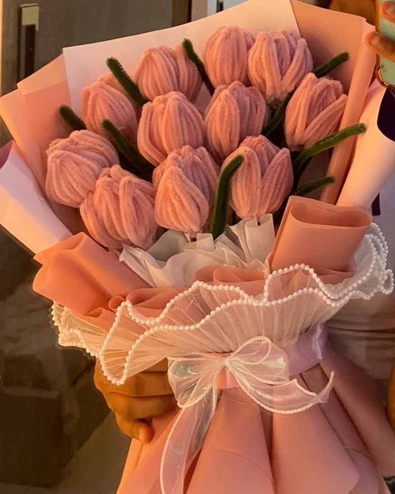

# Floral Flirtss — Luxury Handmade Floral Boutique Website

> **Positioning:** Thoughtfully handmade flowers that stay beautiful forever. Created for meaningful gifts and lasting memories in Hyderabad, Telangana, India.

---

## 🌸 Brand Details

- **Brand:** Floral Flirtss
- **Location:** Hyderabad, Telangana, India
- **WhatsApp:** `+91 9542115708`
- **Instagram:** [https://www.instagram.com/floral.flirtss/](https://www.instagram.com/floral.flirtss/)
- **Signature Products:** Handmade Tulips, Lilies, Sunflowers, Custom Mixed Bouquets, and Special Milestone Keepsake Arrangements.
- **Pricing Policy:** All pricing is customized to order. No fixed prices or discount codes are displayed; patrons connect directly on WhatsApp to confirm bespoke pricing, availability, and delivery arrangements.

---

## 🎨 Luxury Visual Direction & Palette

The website is crafted with a romantic, editorial luxury boutique aesthetic inspired by high-end botanical magazines and bespoke European florists:

| Token | Hex Code | Purpose |
| :--- | :--- | :--- |
| **Cream** | `#FFF9F6` | Warm, elegant canvas background |
| **Soft Blush** | `#F8E8ED` | Section accents, badge pills, and decorative frames |
| **Light Pink** | `#EAB9CA` | Subtle highlights, glowing borders, and petal tones |
| **Rose** | `#D98EAA` | Primary buttons, active underlines, and ribbons |
| **Deep Mauve** | `#806477` | WhatsApp buttons, icons, card borders, and sub-headings |
| **Dark Text** | `#292329` | High-contrast, readable body and heading text |

### Typography
- **Headings:** `Cormorant Garamond` (Google Font) — refined editorial serif with gentle italics.
- **Body:** `Plus Jakarta Sans` (Google Font) — clean, modern, legible sans-serif.
- **Accents:** Delicate handwritten touches and custom SVG botanical art.

---

## 📁 Project Structure

```text
lally/
├── index.html                 # Complete semantic HTML5 webpage (all 11 sections)
├── style.css                  # Responsive luxury CSS3 stylesheet with CSS variables
├── script.js                  # Vanilla JavaScript with WhatsApp integration & validation
├── assets/
│   ├── images/
│   │   ├── favicon.svg               # Brand monogram favicon
│   │   ├── hero-bouquet.svg          # Signature forever bouquet hero illustration
│   │   ├── collection-tulips.svg     # Handmade Tulips collection card
│   │   ├── collection-lilies.svg     # Handmade Lilies collection card
│   │   ├── collection-sunflowers.svg # Handmade Sunflowers collection card
│   │   ├── collection-custom.svg     # Bespoke Mixed Bouquet card
│   │   ├── collection-special.svg    # Special Keepsake Arrangement card
│   │   ├── story-floral.svg          # Hyderabad atelier lifestyle illustration
│   │   ├── insta-1.svg               # Instagram gallery item 1
│   │   ├── insta-2.svg               # Instagram gallery item 2
│   │   ├── insta-3.svg               # Instagram gallery item 3
│   │   ├── insta-4.svg               # Instagram gallery item 4
│   │   ├── insta-5.svg               # Instagram gallery item 5
│   │   └── insta-6.svg               # Instagram gallery item 6
│   └── icons/                        # Supporting static icon assets
└── README.md                  # Comprehensive customization & developer guide
```

---

## 🚀 How to Open and Preview the Website

### Method 1: Direct File Opening
1. Open the project folder in your file explorer.
2. Double-click `index.html` to open it in your default web browser (Chrome, Edge, Safari, Firefox).
3. The site loads immediately with zero dependencies, build steps, or installations.

### Method 2: VS Code Live Server (Recommended for Development)
1. Open the project folder in **Visual Studio Code**.
2. If you don't already have it, install the **Live Server** extension by *Ritwick Dey*.
3. Right-click `index.html` and select **"Open with Live Server"** (or click **Go Live** in the bottom status bar).
4. The site will launch at `http://127.0.0.1:5500/index.html` with instant live reload as you make edits.

---

## 💬 WhatsApp Integration Guide

### Where the Number is Stored
The WhatsApp business contact number is configured once at the very top of `script.js`:

```javascript
// script.js (Line 9)
const WHATSAPP_NUMBER = "919542115708";
```

### How to Change the WhatsApp Number
To update the WhatsApp recipient:
1. Open `script.js`.
2. Locate `const WHATSAPP_NUMBER = "919542115708";`.
3. Replace `"919542115708"` with the new country code + phone number with **no spaces, dashes, or `+` signs** (e.g. for `+91 9876543210`, enter `"919876543210"`).
4. Save the file. Every WhatsApp button across the site (Hero, Navigation, Collections, Custom Form, CTA, and Floating Button) will immediately route to the new number.

### How Booking Enquiries Work
All WhatsApp links utilize standard click-to-chat:
`https://wa.me/${WHATSAPP_NUMBER}?text=${encodeURIComponent(message)}`

- **Collections:** Tapping *"Enquire on WhatsApp"* on any product automatically crafts a message mentioning that exact collection (e.g., *Handmade Tulips*).
- **Custom Bouquet Form:** Tapping *"Send My Bouquet Enquiry"* validates required inputs, rejects whitespace-only fields, prevents past delivery dates, and constructs a neat multiline summary:
  ```text
  Hello Floral Flirtss! 🌸

  I would love to place a custom bouquet enquiry:

  • Name: [Customer Name]
  • Flower Type: [Flower Type]
  • Preferred Colour: [Colour]
  • Bouquet Size: [Size]
  • Occasion: [Occasion]
  • Preferred Delivery Date: [YYYY-MM-DD]
  • Delivery Area/Locality: [Hyderabad Locality]
  • Personal Gift Message: [Message or "None"]
  • Additional Requirements: [Requirements or "None"]

  Please confirm the final price, availability and delivery details before booking.
  ```
- **Booking Transparency:** Both the custom form and footer explicitly clarify to customers that opening WhatsApp prepares the enquiry and they must tap **Send** in WhatsApp. Opening WhatsApp does not confirm a booking—pricing, availability, and delivery are finalized directly with the business in chat.

---

## 📷 How to Replace Photographs

Currently, the website contains bespoke, high-resolution SVG botanical illustrations designed in the brand palette, clearly labeled with placeholder indicators.

To replace any placeholder with your genuine brand photographs:

1. Place your photograph (JPG, PNG, or WebP) inside the `assets/images/` folder:
   - **Hero Bouquet:** `assets/images/hero-bouquet.jpg` (Recommended: `1000 × 1200 px` vertical portrait)
   - **Collection Cards:** `assets/images/collection-tulips.jpg`, etc. (`800 × 1000 px` vertical 4:5 ratio)
   - **Story Atelier:** `assets/images/story-floral.jpg` (`1000 × 800 px` horizontal landscape)
   - **Instagram Gallery:** `assets/images/insta-1.jpg` to `insta-6.jpg` (`800 × 800 px` 1:1 square)
2. Open `index.html` and update the `src` attribute for that image. For example:
   ```html
   <!-- Before -->
   

   <!-- After -->
   
   ```
3. Save `index.html`. Your real photograph will inherit all styling, hover zooms, and responsive borders automatically.

---

## ✍️ How to Edit Product Details & Categories

- **To update category names or descriptions:** Open `index.html` and navigate to `id="collections"`. Edit the `<h3>`, `<p class="card-desc">`, and the `data-product="..."` attribute on the WhatsApp button:
  ```html
  <button type="button" class="btn btn-whatsapp btn-product-enquiry" data-product="Handmade Hydrangeas">
    Enquire on WhatsApp
  </button>
  ```
- **To add new flower varieties to the Custom Bouquet Form:** Open `index.html` and navigate to `id="flowerType"`. Add a new `<option>`:
  ```html
  <option value="Hydrangeas">Hydrangeas</option>
  ```
- **To add genuine Customer Reviews:** Open `index.html` and navigate to `id="customer-love"`. Replace the placeholder cards with real testimonials and client photos gathered from your patrons.

---

## ♿ Accessibility & Performance Highlights

- **Semantic HTML5:** Built using `<header>`, `<nav>`, `<main>`, `<section>`, `<article>`, `<aside>`, and `<footer>` tags.
- **Form Validation:** Accessible inline error announcements with `aria-live="polite"`, `aria-required="true"`, and `aria-invalid="true"`.
- **Keyboard Navigation:** Includes a skip-to-content link, accessible hamburger drawer with `Escape` key support, and `:focus-visible` styling with high contrast.
- **Motion Sensitivity:** Respects `prefers-reduced-motion: reduce` by disabling scroll transforms and transitions.
- **Zero Dependencies:** Pure HTML5, CSS3, and vanilla JavaScript for lightning-fast loading and zero maintenance overhead.
